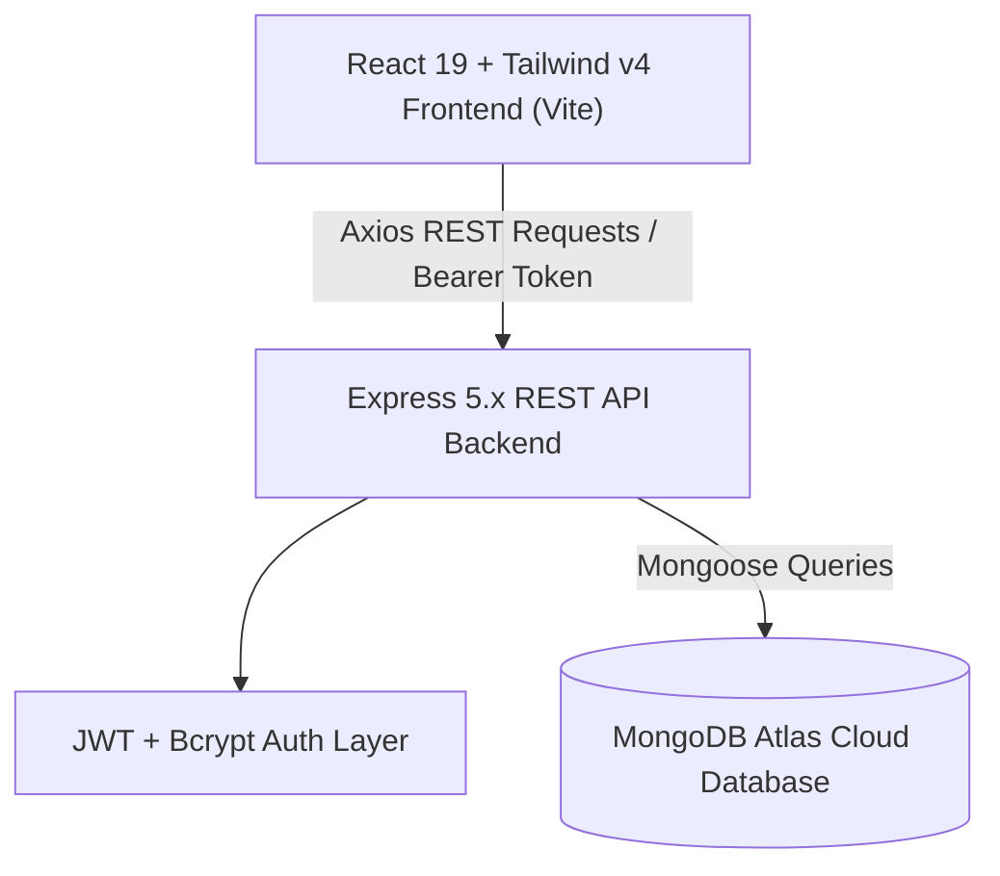

# ReuseCampus 🎓♻️

> **A Verified College-Specific Second-Hand Marketplace for Students**  
> Empowering students to buy, sell, donate, and pass down textbooks, calculators, lab gear, and hostel essentials safely within their verified campus community.

[](https://react.dev/)
[](https://vitejs.dev/)
[](https://tailwindcss.com/)
[](https://nodejs.org/)
[](https://expressjs.com/)
[](https://www.mongodb.com/)
[](https://jwt.io/)
[](LICENSE)

---

## 🌟 Overview

Every semester, students spend thousands of rupees on engineering textbooks, lab coats, drafters, scientific calculators, and hostel appliances—only to have them sit unused after examinations. Meanwhile, incoming juniors struggle to purchase the exact same items at full retail prices.

**ReuseCampus** bridges this campus gap with a dedicated, trusted peer-to-peer marketplace:
- **Zero Middleman Commissions**: 100% of the transaction goes directly between students.
- **Campus Verified**: Access is restricted to institutional student emails (e.g., RJIT `@rjit.ac.in`), eliminating non-student scammers and marketplace fraud.
- **Direct Handover**: Connect directly on WhatsApp or campus email for same-day handover in hostels, canteen, or campus gates.

---

## 🚀 Key Features

### 1. Verified Campus-Only Authentication
- Requires official college institutional email addresses (e.g., `0902cs241008@rjit.ac.in`).
- Non-college or disposable email domains (`@gmail.com`, `@yahoo.com`) are rejected at registration with clear guidance.
- Secure password hashing with `bcryptjs` and session tokens powered by JSON Web Tokens (`JWT`).

### 2. Instant Peer-to-Peer Communication
- **WhatsApp Instant Connect**: One-click direct chat link (`https://wa.me/...`) with pre-filled greeting and item details for rapid scheduling.
- **Campus Email Relay**: Instant `mailto:` modal trigger with customized subject line and campus meeting inquiry.
- **Copy Details**: Fallback clipboard button to share seller information with roommates or friends.

### 3. Seller Dashboard (`MyListings.jsx`)
- **Metric Summaries**: Real-time counters showing Total Items, Active Listings (`AVAILABLE`), and Completed Sales (`SOLD`).
- **Mark as Sold Toggle**: Immediate state transition from `AVAILABLE` to `SOLD` (and vice-versa for relisting) without reloading.
- **Edit Listing Modal**: Modify item title, condition, category, price, and description with photo replacement options.
- **Safe Deletion**: Soft confirmation dialog protecting against accidental listing deletions.

### 4. Sold Item Lifecycle & Transparency
- Sold listings remain discoverable when filtered, maintaining market price benchmarks.
- Automated `SOLD OUT` watermarks and darkened thumbnail treatments.
- WhatsApp chat is disabled for sold items with a clear banner notification: *"This item has already been sold"*.

### 5. Client-Side HTML5 Canvas Image Compression
- User-uploaded photos from mobile devices or webcams are automatically downscaled and compressed to optimized JPEG Data URLs on client canvas before transfer.
- Prevents database bloating, optimizes memory usage, and ensures snappy loading on mobile campus Wi-Fi networks.

### 6. Interactive Campus Profile Drawer
- Easily accessible by tapping the student avatar chip in the navbar.
- Displays locked verified college email and institutional affiliation.
- Allows students to update their display name and WhatsApp phone number in real-time across the app without re-logging in.

### 7. Search, Filter & INR Localization
- Live debounced keyword search matching titles and descriptions.
- Filter pills by Category (Books, Lab Equipment, Electronics, Stationery, Clothing, Furniture, etc.).
- Condition filters (New, Like New, Good, Fair).
- Formatted in Indian Rupee (`₹`) with support for ₹0 (Free / Donation) items.

---

## 🏗️ System Architecture & Tech Stack



| Layer | Technology | Details |
|---|---|---|
| **Frontend Framework** | React 19 + Vite 8 | Ultra-fast client build, modular functional components |
| **Styling & UI** | Tailwind CSS v4, Lucide React | Modern aesthetic, micro-animations, mobile responsive |
| **Routing & State** | React Router v7, AuthContext | Client-side routing, protected routes, reactive user session |
| **Backend Runtime** | Node.js 18+ & Express 5 | RESTful architecture, middleware pipelines |
| **Database & ODM** | MongoDB Atlas, Mongoose 9 | Document persistence, schemas, virtuals, population |
| **Security & Tokens** | JSON Web Tokens (`jsonwebtoken`), `bcryptjs` | Stateless bearer authentication, salted password hashing |
| **CORS & Environment** | `cors`, `dotenv` | Multi-environment support (Vite dev & production origins) |

---

## 📁 Repository Directory Structure

```text
Reuse@campus/
├── backend/
│   ├── config/
│   │   └── db.js                 # MongoDB Atlas Mongoose connection
│   ├── controllers/
│   │   ├── authController.js     # Register, Login, Current User
│   │   ├── listingController.js  # CRUD, Status toggle, Filter queries
│   │   └── userController.js     # Profile retrieval and PUT update
│   ├── middlewares/
│   │   ├── authMiddleware.js     # Protect route with JWT verification
│   │   └── errorMiddleware.js    # 404 handler and global exception catcher
│   ├── models/
│   │   ├── Listing.js            # Listing schema, categories, conditions
│   │   └── User.js               # User schema, institutional email validator
│   ├── routes/
│   │   ├── authRoutes.js         # /api/auth endpoints
│   │   ├── listingRoutes.js      # /api/listings endpoints
│   │   └── userRoutes.js         # /api/users endpoints
│   ├── .env.example              # Sample backend environment configuration
│   ├── package.json              # Backend dependencies and scripts
│   └── server.js                 # Express server bootstrap, CORS, health-check
│
├── frontend/
│   ├── public/                   # Public static assets
│   ├── src/
│   │   ├── assets/               # Brand assets and images
│   │   ├── components/
│   │   │   └── Navbar.jsx        # Navigation bar & Student Profile modal
│   │   ├── context/
│   │   │   └── AuthContext.jsx   # Global auth provider and session state
│   │   ├── pages/
│   │   │   ├── CreateListing.jsx # Multi-input form with image compression
│   │   │   ├── Home.jsx          # Marketplace feed, filter bar & detail modal
│   │   │   ├── Login.jsx         # Institutional login page
│   │   │   ├── MyListings.jsx    # Seller dashboard with stats and actions
│   │   │   ├── NotFound.jsx      # 404 page
│   │   │   └── Register.jsx      # Student registration with domain validation
│   │   ├── services/
│   │   │   └── api.js            # Axios client with JWT request interceptor
│   │   ├── utils/
│   │   │   ├── formatters.js     # Currency and date utilities
│   │   │   └── imageCompressor.js# Client canvas image compressor
│   │   ├── App.jsx               # Application root routes
│   │   ├── index.css             # Tailwind CSS entrypoint
│   │   └── main.jsx              # Vite React DOM entrypoint
│   ├── .env.example              # Sample frontend environment configuration
│   ├── package.json              # Frontend dependencies and scripts
│   └── vite.config.js            # Vite configuration with Tailwind CSS v4
│
├── .gitignore                    # Root git exclusion file (node_modules, dist, .env)
├── PRD.md                        # Complete Product Requirement Document
└── README.md                     # Comprehensive project documentation
```

---

## 📡 REST API Reference

All protected endpoints require the header `Authorization: Bearer <jwt_token>`.

### 1. System Health
| Method | Endpoint | Access | Description |
|---|---|---|---|
| `GET` | `/api/health` | Public | Deployment uptime and health monitoring |

### 2. Authentication (`/api/auth`)
| Method | Endpoint | Access | Description |
|---|---|---|---|
| `POST` | `/api/auth/register` | Public | Register new student with institutional email (`@rjit.ac.in`) |
| `POST` | `/api/auth/login` | Public | Authenticate user and receive JWT bearer token |
| `GET` | `/api/auth/me` | Private | Retrieve session details of currently authenticated user |

### 3. Listings (`/api/listings`)
| Method | Endpoint | Access | Description |
|---|---|---|---|
| `GET` | `/api/listings` | Public | List all items with query filters (`search`, `category`, `condition`, `status`, `minPrice`, `maxPrice`) |
| `GET` | `/api/listings/:id` | Public | Retrieve single listing detail with populated seller information |
| `POST` | `/api/listings` | Private | Publish a new item listing |
| `PUT` | `/api/listings/:id` | Private (Owner) | Update listing title, price, description, condition, category, or photo |
| `DELETE` | `/api/listings/:id` | Private (Owner) | Permanently remove a listing |
| `PATCH` | `/api/listings/:id/status`| Private (Owner) | Toggle listing status between `AVAILABLE` and `SOLD` |
| `GET` | `/api/listings/my` | Private (Owner) | Fetch all listings posted by the logged-in student |

### 4. User Profile (`/api/users`)
| Method | Endpoint | Access | Description |
|---|---|---|---|
| `GET` | `/api/users/me` | Private | Fetch current student profile with total listings count |
| `PUT` | `/api/users/me` | Private | Update student display name and WhatsApp phone number |

---

## ⚙️ Environment Variables

### Backend (`backend/.env`)
Create a `.env` file in the `backend/` directory:
```env
PORT=5000
NODE_ENV=development
MONGO_URI=mongodb+srv://<username>:<password>@cluster.mongodb.net/reusecampus?retryWrites=true&w=majority
JWT_SECRET=your_super_secret_jwt_key_here_rjit_2026
JWT_EXPIRES_IN=7d
CLIENT_URL=http://localhost:5173
```

### Frontend (`frontend/.env`)
Create a `.env` file in the `frontend/` directory (optional for local development, defaults to `http://localhost:5000/api`):
```env
VITE_API_URL=http://localhost:5000/api
```

---

## 🛠️ Local Installation & Setup

### Prerequisites
- [Node.js](https://nodejs.org/) (v18.0.0 or higher)
- [Git](https://git-scm.com/)
- A free [MongoDB Atlas](https://www.mongodb.com/cloud/atlas) cluster URI (or local MongoDB daemon)

### 1. Clone the Repository
```bash
git clone https://github.com/abhishekpachori04-cpu/ReuseCampus.git
cd ReuseCampus
```

### 2. Configure Backend
```bash
cd backend
npm install
# Create .env from template
cp .env.example .env
# Fill in your MONGO_URI and JWT_SECRET
npm run dev
```
*Backend server will start on [http://localhost:5000](http://localhost:5000).*

### 3. Configure Frontend
Open a new terminal window:
```bash
cd frontend
npm install
npm run dev
```
*Frontend dev server will start on [http://localhost:5173](http://localhost:5173).*

### 4. Production Build Verification
To ensure production asset bundling succeeds:
```bash
cd frontend
npm run build
```

---

## 🛡️ Security & Integrity Highlights

1. **Email Domain Filtering**: Enforced both on client validation and server schema level (`User.js`), preventing non-institutional sign-ups.
2. **Resource Ownership Authorization**: Strict ownership validation (`listing.seller.toString() === req.user._id.toString()`) prevents unauthorized edits, status modifications, or deletions.
3. **Payload Sanitization**: Server-side string trimming, escaped RegExp search queries to avoid ReDoS, and validated numeric price parsing.
4. **CORS Restrictions**: Configured to whitelist authorized client origins with fallback protection in production mode.

---

## 👨‍💻 Author

**Abhishek Pachori**  
*Rustamji Institute of Technology (RJIT), BSF Academy, Tekanpur*  
- **GitHub**: [@abhishekpachori04-cpu](https://github.com/abhishekpachori04-cpu)
- **Email**: `0902cs241008@rjit.ac.in`

---

## 📄 License

This project is licensed under the [ISC License](LICENSE).
